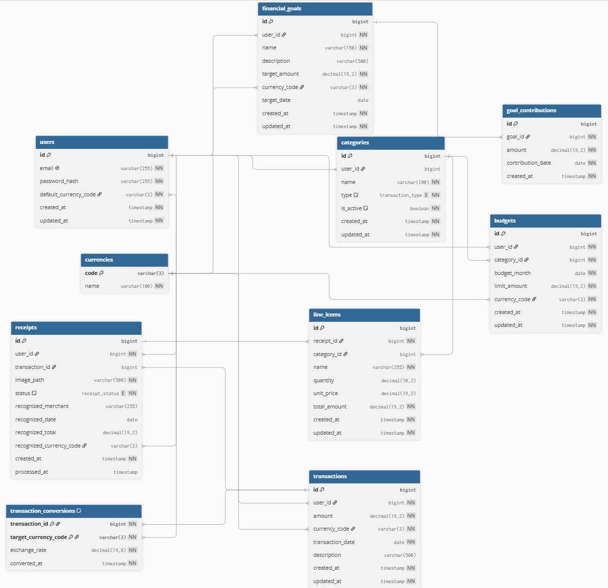

# Logical Database Schema

## Overview

The Personal Finance Manager API uses PostgreSQL as its relational database management system.

The database schema is managed using Liquibase migrations.

The current database model consists of 9 tables:

- currencies
- users
- categories
- transactions
- transaction_conversions
- budgets
- financial_goals
- goal_contributions
- receipts

## Database Diagram

The database diagram is available here:

An additional diagram showing the planned receipt line items functionality is available here:

[Planned Database Model](db%20model%20with%20line%20items.jpg)

Note: Receipt line items are planned functionality and are not included in the current Liquibase schema.

## Table Relationships

| Parent Table | Child Table | Relationship |
|---|---|---|
| currencies | users | One-to-Many |
| currencies | transactions | One-to-Many |
| currencies | transaction_conversions | One-to-Many |
| currencies | budgets | One-to-Many |
| currencies | financial_goals | One-to-Many |
| currencies | receipts | One-to-Many |
| users | categories | One-to-Many |
| users | transactions | One-to-Many |
| users | budgets | One-to-Many |
| users | financial_goals | One-to-Many |
| users | receipts | One-to-Many |
| categories | transactions | One-to-Many |
| categories | budgets | One-to-Many |
| transactions | transaction_conversions | One-to-One |
| transactions | receipts | One-to-One |
| financial_goals | goal_contributions | One-to-Many |

## Primary Keys

Each table has a primary key ensuring that its records can be uniquely identified.

Most tables use a BIGINT identifier.

The currencies table uses the currency code as its primary key.

The transaction_conversions table uses transaction_id as both its primary key and foreign key.

## Referential Integrity

Relationships between tables are enforced using foreign key constraints.

This ensures that records reference valid parent records.

## Database Schema Creation

The schema is created automatically by Liquibase migrations when the Spring Boot application starts.

Master changelog:

`src/main/resources/database/changelog/db.changelog-master.yaml`

Initial migration:

`src/main/resources/database/changelog/V1.0/init-scheme.yaml`

The database tables must not be created manually.

## Additional Documentation

- [Database Architecture](architecture.md)
- [Data Dictionary](DATA_DICTIONARY.md)
- [Database Diagram](DB_Scheme1.jpg)
