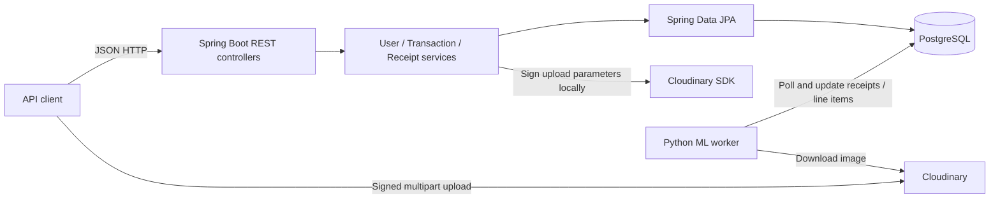
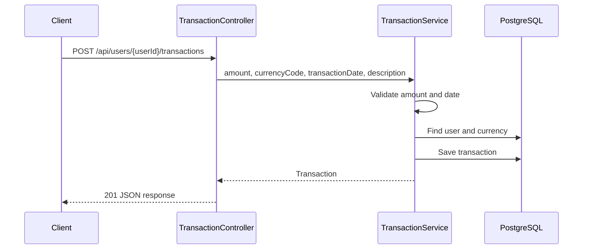
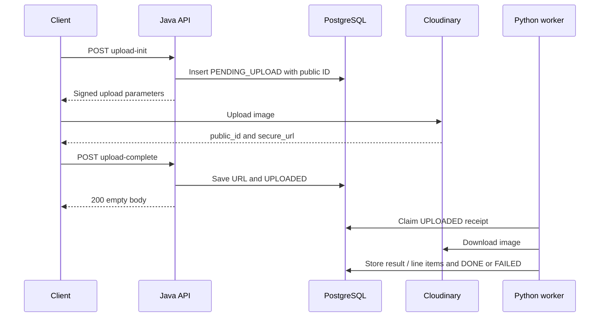

# Architecture and interactions

The React review version currently uses its own mock API, not the Java API. PostgreSQL is the shared contract between the Java application and Python worker. Liquibase owns schema changes; the worker must agree on column names and receipt status values. User and transaction controllers map data to response records rather than expose password hashes or persistence entities directly.

## Transaction lifecycle

## Receipt lifecycle

The worker lifecycle is a source-level description, not an end-to-end verified contract. There is no implemented status/result read API. The API does not independently confirm that Cloudinary uploaded the file; it checks the supplied public ID and URL prefix.
