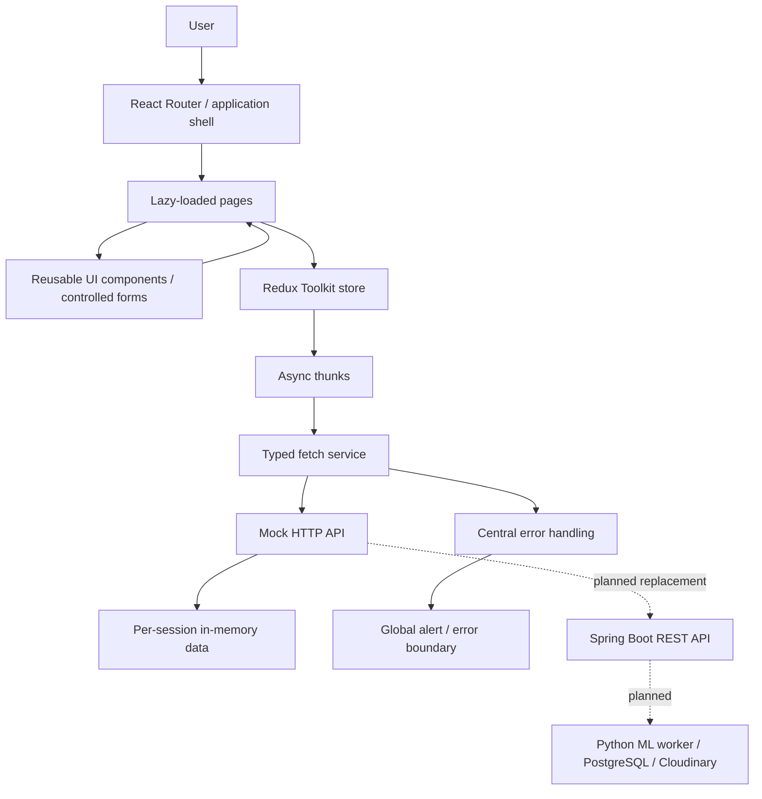
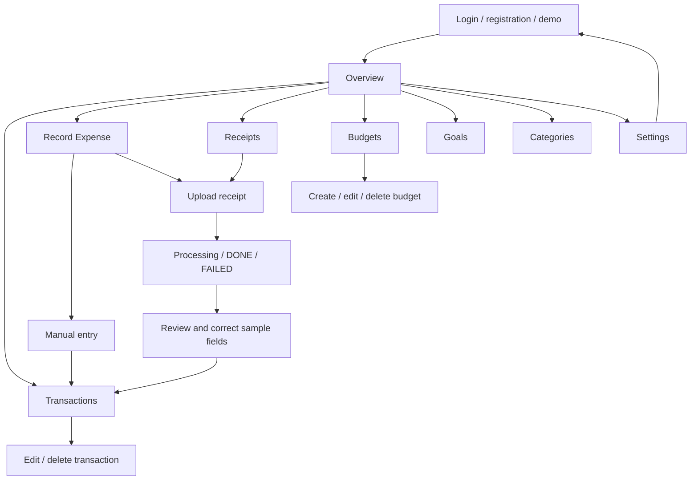

# Front-end architecture and design rationale

## Component-based SPA with unidirectional data flow

React components divide the UI into pages, forms, summary cards, tables, budget rows and a layout. Pages own navigation and use local state for form values and filters. Redux Toolkit owns shared user, data, theme, request count and error state; successful mutations replace the data snapshot. This keeps dashboard, budgets and transactions consistent. The API wrapper owns fetch, status mapping and logging; receipt polling uses the same wrapper. The Vite mock middleware is a separate server-side module. Each route is imported lazily for code splitting. The UI uses reusable custom components rather than a UI kit to preserve the BA visual language.

| Technology                            | Rationale                                                             |
| ------------------------------------- | --------------------------------------------------------------------- |
| React + TypeScript                    | Matches BA solution concept; reusable components and typed API models |
| Vite                                  | Development server and production bundling with lazy chunks           |
| React Router                          | SPA navigation without full page reloads                              |
| Redux Toolkit                         | Central shared state and async request lifecycle                      |
| Fetch                                 | Native HTTP client with centralized typed wrapper                     |
| CSS variables + grid                  | Consistent custom design, responsive breakpoints, theme tokens        |
| Lucide + SVG                          | Scalable icons and a lightweight category chart                       |
| Vitest / Testing Library / Playwright | Component behavior and complete user workflows                        |

## Navigation diagram

All eight authenticated sections are available from the shared sidebar or mobile menu. Unknown paths display a 404 view. Unauthenticated users see the auth screen.

## Key flows

1. Manual expense (US-03, US-04, US-11): Overview → Record Expense → Manual Entry → valid merchant, date, amount, category → save → Transactions. Required/invalid data is rejected; network or server errors show an alert and retain entered fields. The preview reflects current input.
2. Receipt-based expense (US-07, US-24, US-25): Record Expense → Upload Receipt → choose supported image → processing → DONE → review/correct sample fields and line items → save → Transactions. Invalid image or request errors are displayed; manual entry remains available. The mock does not run OCR; the reviewer can explicitly simulate FAILED. Real upload and worker lifecycle are planned for integration.
3. Monthly budget (US-08, US-17, US-18): Budgets → choose month/category → enter positive limit → save → progress recalculated from expenses. Duplicate category/month limits are rejected; edit an existing budget instead.

## Design evolution

Appendix B.5–B.9 provides the visual foundation: left navigation, light neutral background, blue accents, summary cards, budget progress and receipt review. The implementation uses the same section names and functional patterns, with a collapsible mobile menu, dark theme, responsive grids and accessible labels. The final visual match and accessibility must be checked after running the application.
